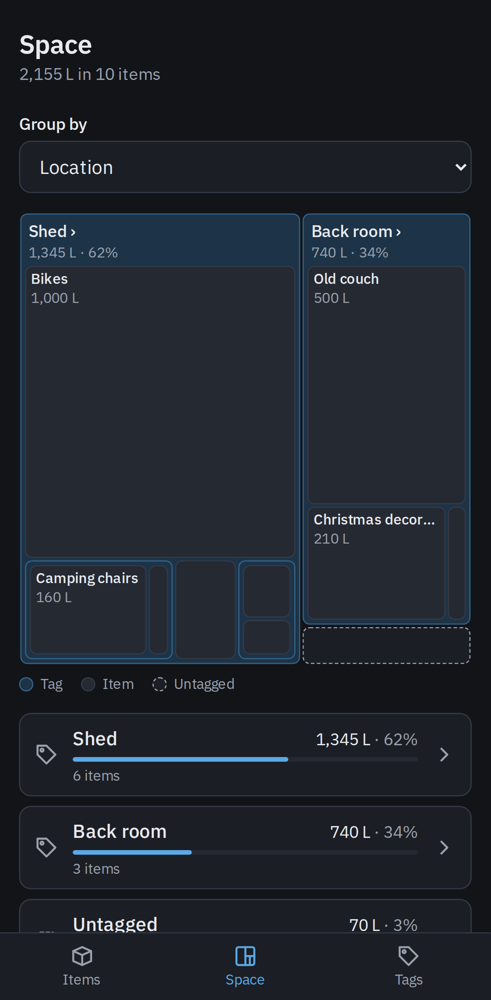
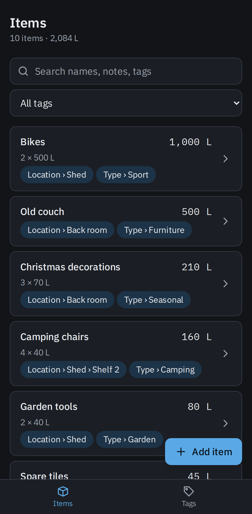
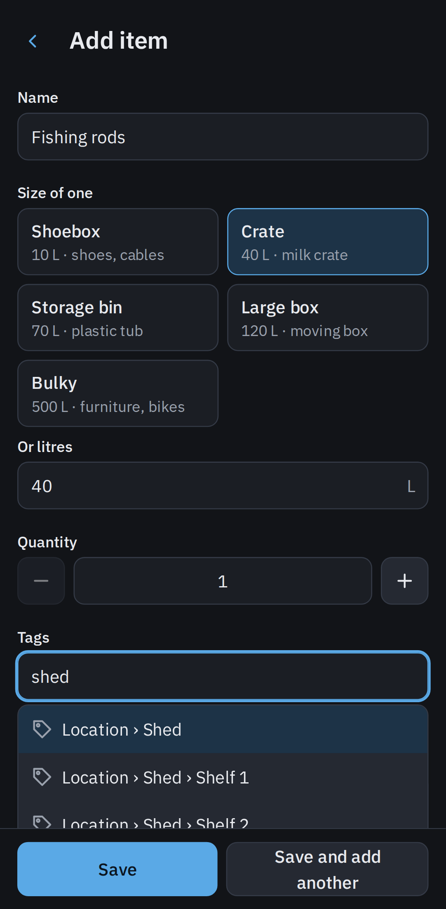
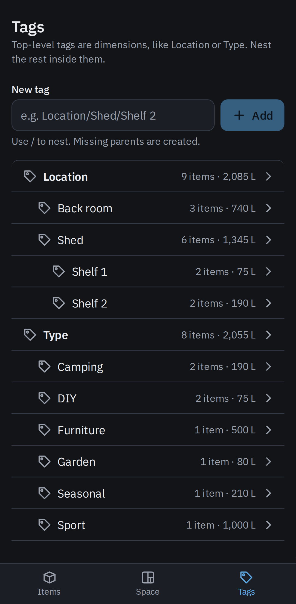

# Shelf Organiser

A self-hosted app for cataloguing what's in your shed or back room, so you can see what takes up the space.

- Add items from your phone with a one-tap size preset, or type the litres
- Dictate a list: tap the microphone and speak; it's written down on your phone, then Claude turns it into drafts you check before saving (optional, needs an Anthropic API key)
- Tag items with nested tags such as `Location › Shed › Shelf 2`, creating them as you type; rename, move, merge or delete tags without losing items
- Let Claude propose Type tags, one item at a time or for everything untagged at once, building the tag tree for you; nothing changes until you accept (optional, same key)
- See the biggest things at a glance on a treemap by Location, Type or any other top-level tag, and tap in to drill down
- Search and rank items by the total space they take, filtered to any tag

<table>
  <tr>
    <td></td>
    <td></td>
    <td></td>
    <td></td>
  </tr>
  <tr><td>Space</td><td>Items</td><td>Add item</td><td>Tags</td></tr>
</table>

## Deploy

CI publishes `ghcr.io/simonpratt/shelf-organiser` for amd64 and arm64: `latest` from master, `X.Y.Z` from `vX.Y.Z` tags, and `sha-<short>` for every build. To build it yourself, `docker build -t shelf-organiser .` (the build downloads the speech model from Hugging Face, so it needs internet access). It serves on port 8080 and keeps its SQLite database in the `/data` volume. The container runs as UID/GID 65532, so a bind-mounted `/data` must be writable by that user.

## Configuration

| Variable | Default | Description |
|---|---|---|
| `DATA_DIR` | `/data` | Directory holding `shelf.db` |
| `PORT` | `8080` | Listen port |
| `ANTHROPIC_API_KEY` | empty | Turns on dictation and tag proposals. Without it the app is typed entry and hand tagging only |
| `APP_USERNAME`, `APP_PASSWORD` | empty | Set both to turn on the login page. Without them there is no login |

For example, with a login:

```sh
docker run -d -p 8080:8080 -v shelf-data:/data \
  -e APP_USERNAME=simon -e APP_PASSWORD='a long passphrase' \
  ghcr.io/simonpratt/shelf-organiser
```

Test-only settings are in `.env.example`.

## Notes

- The login is off unless `APP_USERNAME` and `APP_PASSWORD` are set; without it, run the app on a trusted LAN only. Logging in keeps the browser logged in for 90 days from its last use, across restarts; changing either variable logs every browser out. Serve it over HTTPS (a reverse proxy setting `X-Forwarded-Proto` is enough) so the password and cookie aren't sent in the clear.
- Deleting a tag also deletes the tags inside it; the items stay, moving up to its parent tag. Renaming or moving a tag onto an existing one offers to merge them.
- Speech is turned into text on the phone by a Whisper model the app serves itself (about 105 MB, downloaded on first use of Dictate and then cached); the audio never leaves the phone. Only the text, plus your tag paths, goes to Anthropic (`docs/adr/0003-speech-to-text-in-the-browser-with-whisper.md`).
- Browsers only allow the microphone over HTTPS (or on `localhost`). Served over plain HTTP on the LAN, Dictate falls back to typing, or your keyboard's own microphone.
- Suggest tags and Organise send item names, notes and tag paths to Anthropic (`docs/adr/0002-claude-proposes-type-tags-on-request.md`).

## Development

Go 1.27, Node 22 and pnpm (via corepack). `make dev` runs the server and Vite, `make check` the linters and unit tests, `make e2e` the Playwright suite and `make docker` the image. The domain glossary is `CONTEXT.md`, the API spec `apps/server/openapi/openapi.yaml`, and agent notes `CLAUDE.md`.
